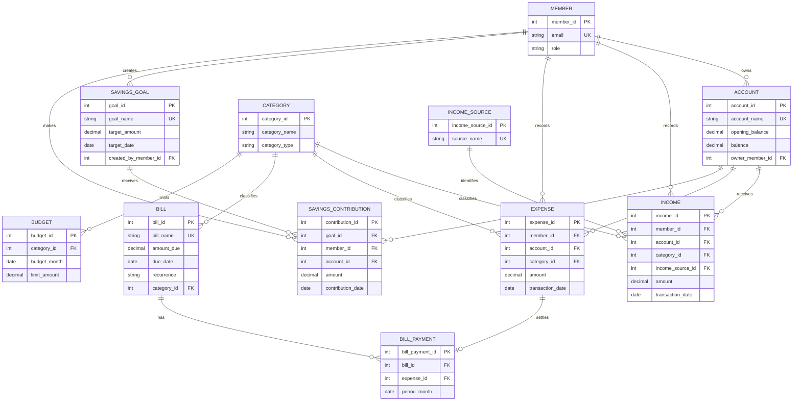

# Family Finance Database Schema

The database contains eleven normalized tables, three views, and database-enforced
constraints/triggers. Schema SQL is applied in numbered order by
`python -m src.database.migrate`.

## Entity relationship diagram

## Normalization

The tables are in third normal form: each table represents one entity or event,
each non-key attribute depends on the whole key, and relationships are represented
by foreign keys rather than duplicated descriptive data. For example,
`category_type` is stored only in `category`. Income, expense, bill, and budget
rows reference the category and a trigger checks that the referenced category has
the required type. Copying `category_type` into each child table would create
update anomalies and allow contradictory values.

Derived values are intentionally not stored. Monthly totals, bill occurrences,
savings progress, and account reconciliation are calculated by views or reports.

## Rule enforcement

| Rule | Enforcement |
| --- | --- |
| Positive income, expense, contribution amounts | `CHECK` constraints |
| Non-negative account balances and budget limits | `CHECK` constraints |
| Valid roles, account types, category types, and recurrence values | `CHECK` constraints |
| Lowercase, valid, unique member email | `CHECK` and `UNIQUE` |
| Nonblank names and bounded SQL column lengths | `CHECK` and column definitions |
| Birth date cannot be in the future | `CHECK` |
| Budget month and bill-payment period are month starts | `CHECK` |
| Unique account, bill, goal, source, and category names | `UNIQUE` constraints |
| One budget per category/month | `UNIQUE` |
| One payment per bill/period and one expense per payment | `UNIQUE` |
| Required relationships and safe deletion | Foreign keys with explicit `ON DELETE RESTRICT` |
| Income uses an Income category | `trg_income_category_type` |
| Expense, bill, and budget use Expense categories | Category-type triggers |
| Category type cannot change | `trg_category_type_immutable` |
| Bill-payment expense matches bill category | `trg_bill_payment_category` |
| Account balance starts from opening balance | Service transaction boundary; seed reconciliation |
| Ledger row and balance update are atomic | Service transaction boundary |
| Budget warning near 80% or over limit | Service business logic and budget report `CASE` |
| Recurring bill occurrences and paid status | `v_bill_schedule` |
| Stored balance reconciliation | `v_account_reconciliation` |
| Month-based, end-inclusive report filtering | Report SQL date predicates |
| Nullable report parameters do not cause SQL type errors | Explicit casts in report SQL |
| No row multiplication in monthly totals | Separate aggregate CTEs in `v_monthly_income_vs_expense` |

## Report concept map

| Report | Concepts shown |
| --- | --- |
| `budget_vs_actual` | CTE, JOIN, LEFT JOIN, `COALESCE`, `NULLIF`, `CASE`, percentage |
| `member_spending` | LEFT JOIN with filter in `ON`, `GROUP BY`, `HAVING`, aggregates |
| `category_spending` | LEFT JOIN, `GROUP BY`, category-type filtering |
| `monthly_income_vs_expense` | View, separate monthly aggregations, joined month list |
| `overdue_bills` / `upcoming_bills` | View, `generate_series`, `LATERAL`, LEFT JOIN anti-join |
| `savings_progress` | Aggregate against target, LEFT JOIN, `GREATEST` |
| `account_balances` | View and stored-versus-computed reconciliation |
